# BLACKWATER

Black Ops 1 zombies × cave diving. Solo, single-run, browser game (TypeScript + Three.js).

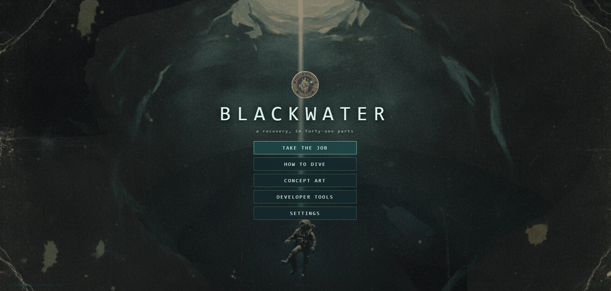

- **The pitch:** [PITCH.md](PITCH.md)
- **What the game is:** [DESIGN.md](DESIGN.md)
- **The world, character, and every asset's identity:** [LORE.md](LORE.md)
- **Build status and next step:** [PLAN.md](PLAN.md) (see the STATUS line and Session Protocol)

Design and lore are **locked** (2026-07-18): build sessions implement and tune; they do not redesign.

## The dive

You go down a flooded sinkhole to recover forty-one people and one artefact.
Air is the clock, the shift bell keeps ringing, and nothing you kill buys you
time.

| | |
|---|---|
| 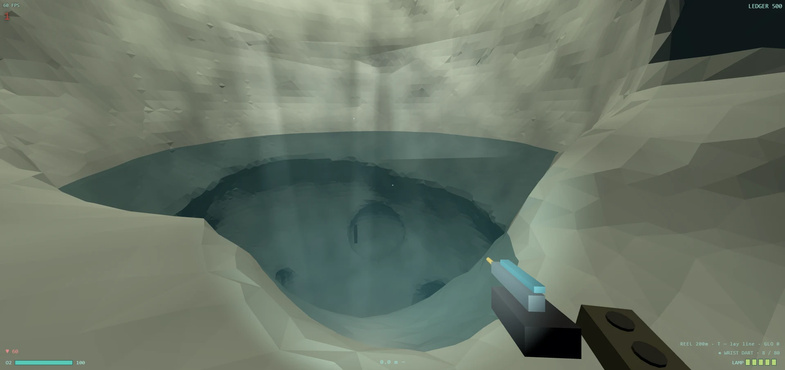 **The shore.** The last dry ground. Everything below it is on your air. | 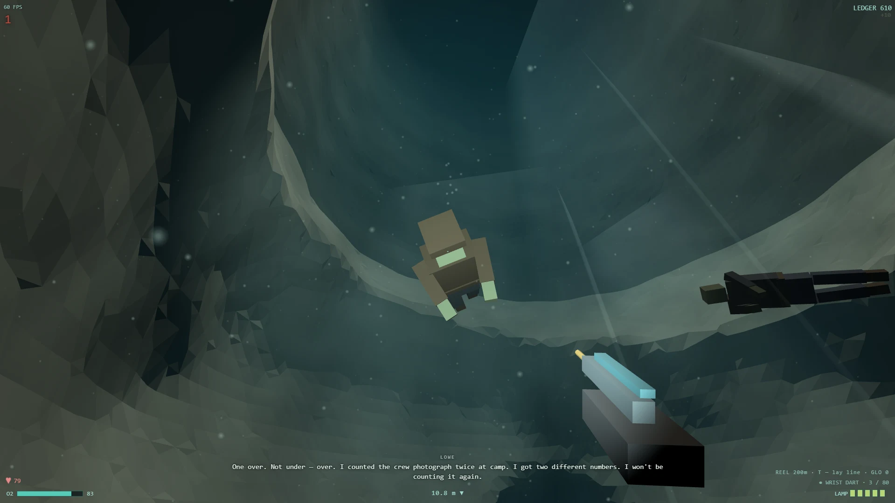 **The crew.** Forty-one to bring up, each one a name, each one talking. |
| 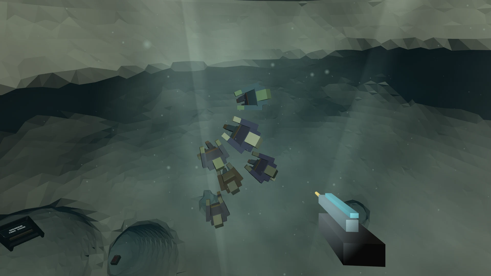 **The Drowned.** They come up the shafts at you, and the shift bell only makes more. | 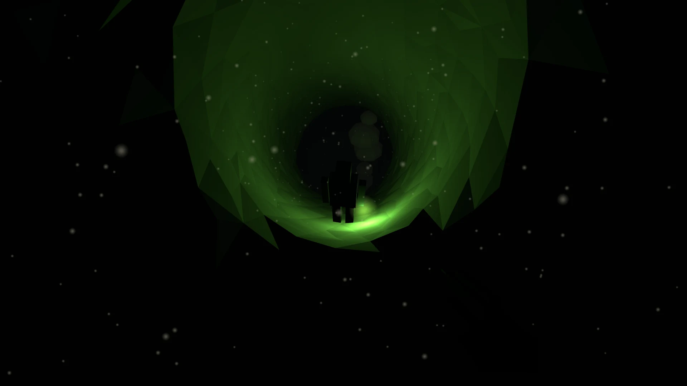 **The Lamp Man.** No AI, no hitbox, no confirmation. He stands, and then he doesn't. |
| 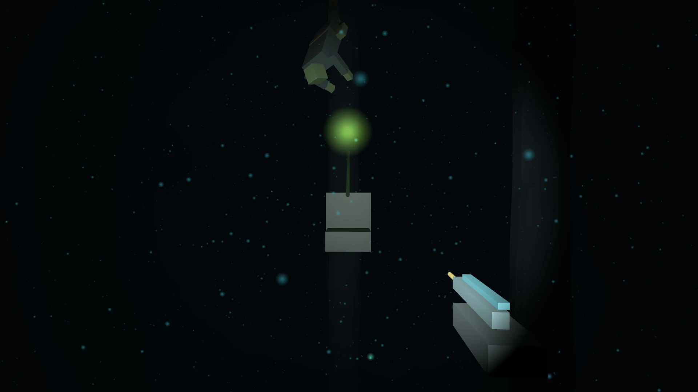 **The Angler.** The lure is the lie — it hangs exactly like the Lamp Man's lamp. | 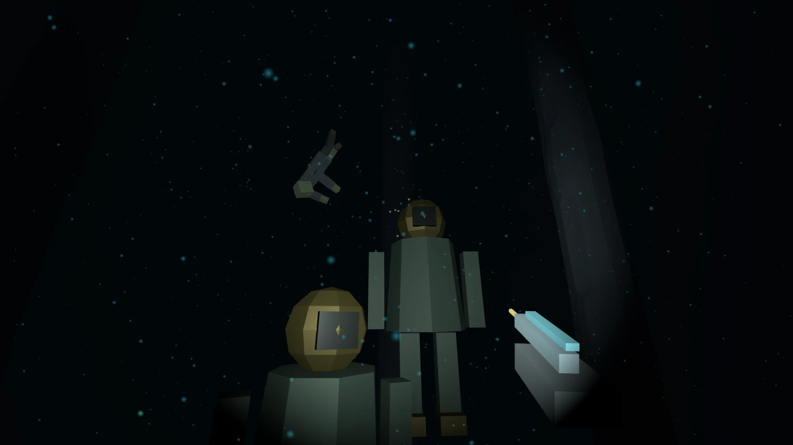 **The Guardians.** Condemned hard-suits, still walking their posts. |
| 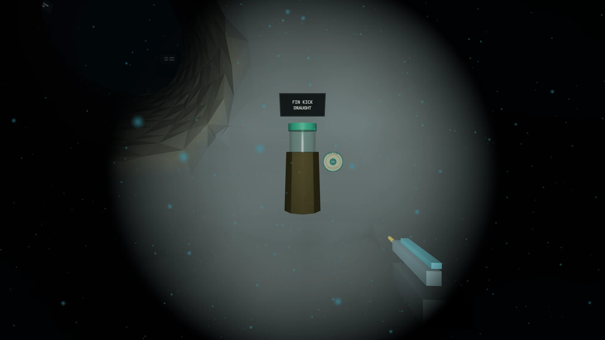 **The draughts.** The site issues; it does not sell. | 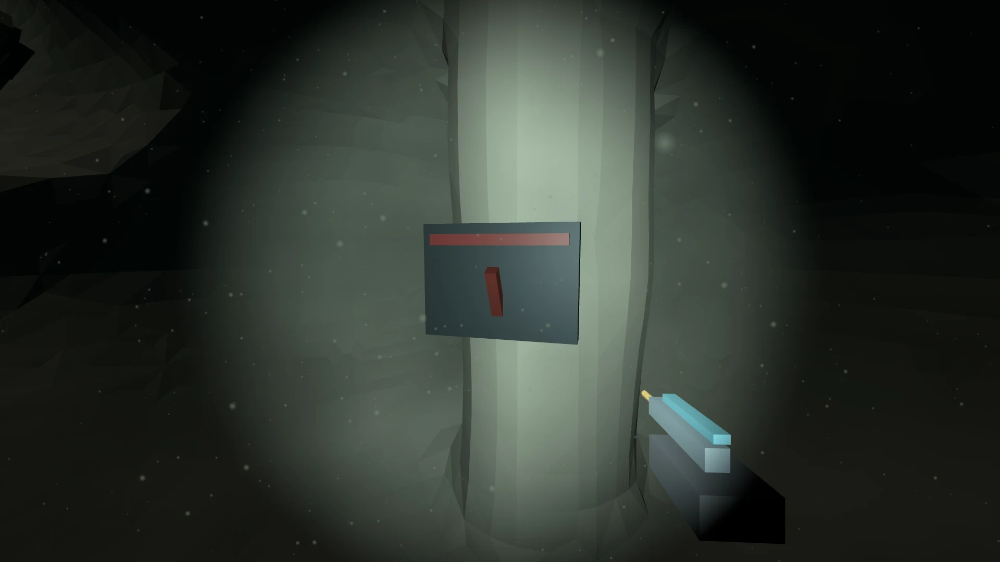 **The power.** Throw it and the arteries light. |
| 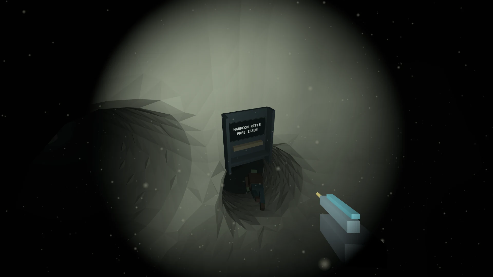 **Free issue.** The belt carries what opens the way down. | 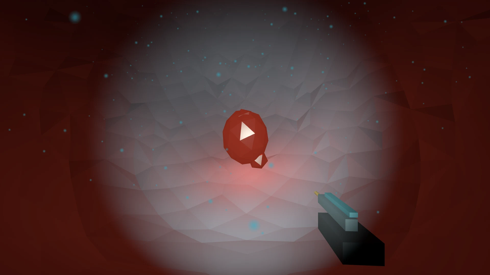 **The Heart.** Lift it and the only advice left is *ascend*. |

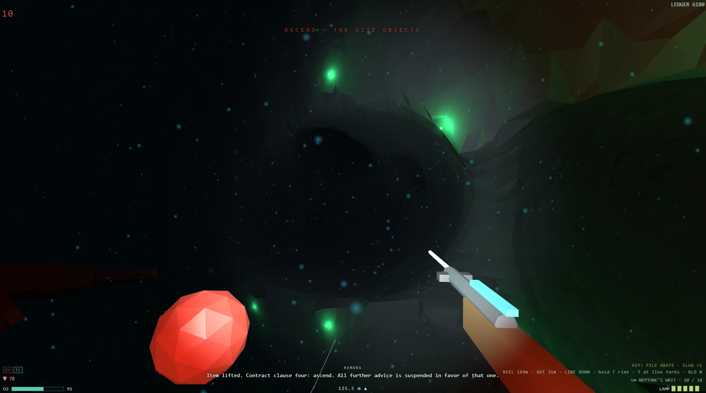

The toolkit ships with the game — the title screen's **DEVELOPER TOOLS** door
opens the level editor the cave was built in:

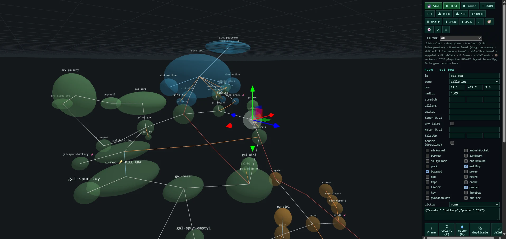

Full-resolution PNGs of every shot are in [`docs/screens/`](docs/screens);
`node scripts/showcase.mjs` rebuilds the WebP set above from them.

## Playing it

- **Double-click `play.bat`** — starts the dev server and opens the game in your browser.
- Or manually: `npm run dev`, then open <http://localhost:5180/> (add `?debug=1` for the debug panel).
- Controls: click the canvas to mouse-look · WASD move · Space/C up/down · Shift fast · **the full key list is in the pause menu** (Esc) and on HOW TO DIVE · F1 debug panel · H hide UI.
- Desktop only by design: pointer lock + WASD. A touch-only device gets an explanatory screen instead (preview it anywhere with `?gate=1`; force the dive with `?anyway=1`).

## Deploying

Static site — no server, no API calls at runtime. Deployed as a **Cloudflare
Worker serving static assets** (same setup as `Bloodtailor/blog`), at the root
of its own subdomain.

| setting | value |
|---|---|
| build command | `npm run build` |
| deploy command | `npx wrangler deploy` (config: `wrangler.jsonc`, assets → `dist`) |
| production branch | `main` |
| subpath deploy | `BW_BASE=/sub/ npm run build` — defaults to `/`, which is what we ship |

`public/_headers` (copied into `dist/` by the build — never edit `dist/`, it is
gitignored) sets the cache policy: immutable on the fingerprinted `/assets/*`,
60 s on the manifests and `tracks.json`.

On Windows, set `BW_BASE` from PowerShell (`$env:BW_BASE='/sub/'`) — Git Bash
rewrites a leading-slash value into a Windows path.

The toolkit is part of the public build — the title screen has a **DEVELOPER
TOOLS** door to the level editor, the map viewer, and the panels. Without a dev
server to write files, the editor's SAVE keeps the map in the browser
(`⬇ JSON` / `⬆ JSON` move a real `layout.json` in and out, `🗑 draft` restores
the shipped cave, and `?stock=1` ignores a draft), the tuning panel's SAVE keeps
its numbers in the browser (`⬇` downloads them as `tuning.overrides.json`), and
screenshots download instead of landing in `docs/screens/`.

Art pipeline: `node scripts/webp-assets.mjs` converts `public/images/**` to
WebP (q90, full-res) and rewrites both manifests; the PNG originals move to
`art-src/`, which is not part of the build.

Built autonomously by Claude Code. `.env` holds API keys and is never committed.
